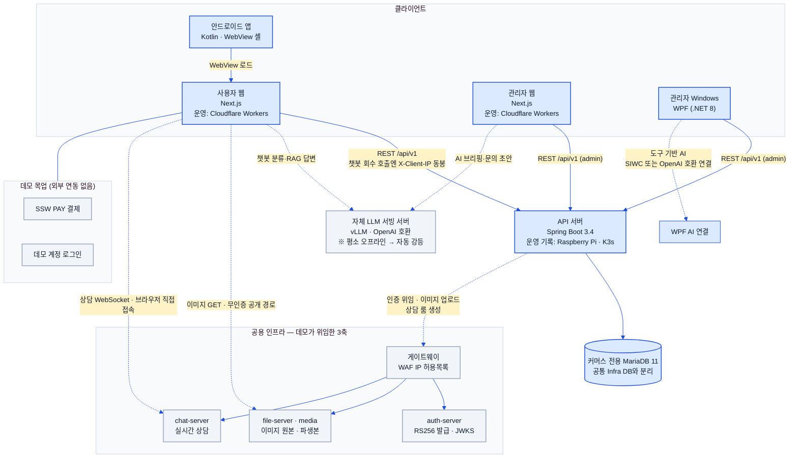
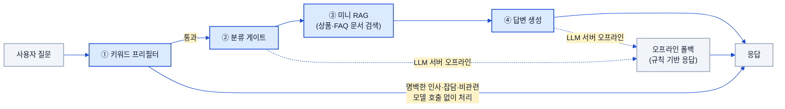

# 시스템 아키텍처 (System Architecture)

> 상태: 소스와 보유 운영 문서 대조 · 최종수정: 2026-10-15

소스 구현은 2026-10-15, 운영 토폴로지는 2026-09-22까지의 보유 문서 기준이다.
최신 로컬 변경과 운영 배포를 구분하며 오늘의 실서비스 상태를 검증한 결과는 아니다.

클라이언트 4종 · API 서버 1종 · MariaDB · 외부 LLM 서빙으로 구성된 데모의 전체 구조를 정의한다.
데이터 스키마 정본은 내부 데이터 모델 설계 문서(비공개)이며, 이 문서는 **구성 요소와 그 사이의 통신**을 다룬다.
개별 도메인의 상태머신·시퀀스는 종류별 다이어그램 문서로 분리했고(§6), 각 구성 요소가 어디서 도는지는
§5에 요약한다.

---

## 1. 전체 구성도



노드 라벨의 운영 정보는 보유 운영 문서의 실행 환경이다(§5). 실배포 버전의 현재 확인과는 구분한다.

실선은 주요 업무 경로, 점선은 AI·공통 서비스의 위임 경로다. 점선 경로마다 장애 처리 범위가 다르다.
공용 인프라가 점선인 것도 같은 이유다 — 인증은 로컬 HS256으로, 이미지는 로컬 정적으로 자동 강등된다
([`09-infra-integration.md`](09-infra-integration.md) §1). 안드로이드 앱은 서버를 직접 부르지 않고
사용자 웹을 WebView로 싣는 셸이라 API 화살표가 웹에서만 나간다(§2.4).

---

## 2. 구성 요소

### 2.1 사용자 웹 (`ssw-e-commerce-demo-web`)

Next.js 16 App Router · React 19 · TypeScript · Tailwind v4. 고객이 보는 모든 화면을 담당한다.
카탈로그·상품 상세·장바구니·주문·마이페이지·알림함·문의·챗봇 셸이 여기 있다.
프로토타입(`design/prototype`)의 시각·구조를 그대로 재현하는 것이 완료 기준이며,
페이지 전환 애니메이션과 오버레이로 앱형 UX를 낸다.
운영에서는 **Cloudflare Workers**에서 돈다(`@opennextjs/cloudflare`).
서버가 보는 접속 주소는 워커 주소라 무의미하므로, 챗봇 회수 호출에는 워커가 본 실제 클라이언트 IP를
`X-Client-IP` 헤더로 실어 보낸다([`06-ops-flows.md`](06-ops-flows.md) §4).

### 2.2 관리자 웹 (`ssw-e-commerce-demo-admin-web`)

같은 스택(Next.js 16 · React 19 · Tailwind v4)에 디자인 토큰을 사용자 웹과 공유한다.
staff 역할(`ADMIN`·`SELLER_SUPPORT`·`CUSTOMER_SUPPORT`)만 로그인할 수 있고, `CUSTOMER`는 거부된다.
대시보드·주문 칸반·리뷰 블라인드·문의 답변·상품 CRUD·챗봇 세션 관리 같은 운영 화면과,
LLM 서버를 쓰는 AI 브리핑·문의 초안이 함께 들어 있다.
운영 실행 환경은 2026-08-06에 **클라우드 VM(Next standalone + systemd)에서 Cloudflare Workers로 이관**했고,
전용 도메인도 새로 발급했다.

**자연어 통계는 구현돼 있다.** 서버의 고정 지표·허용 파라미터를 선택하고 검증·조회·해석하는 구조다.
관리자 웹·WPF 화면을 제공하며, Workers에서 MariaDB에 직접 연결하거나 임의 SQL을 만들지 않는다.
추천 질문·결과 표·부분 실패·해석 재시도의 최신 UI는 로컬 변경을 포함한다
(`/api/v1/admin/stats/**`, [`06-ops-flows.md`](06-ops-flows.md) §5).

### 2.3 관리자 Windows (`ssw-e-commerce-demo-admin-windows`)

WPF · .NET 8 · MVVM(CommunityToolkit) 데스크톱 앱. PC 네이티브 관리 역량 시연이 목적이다.
서버와는 관리자 웹과 동일한 `/api/v1` 관리자 엔드포인트로 통신한다.
대시보드·주문·상품·매장·문의·상담·리뷰·챗봇 관리·감사로그·자연어 통계 10개 메뉴를 역할에 따라 제공한다.
필터·다중 선택·CSV와 도구 기반 어시스턴트를 구현했다. AI 연결은 SIWC(Sign in with ChatGPT) 또는
OpenAI 호환 서버를 선택하며 사용량·컨텍스트 표시와 수동/자동 압축을 지원한다.
최신 AI/UI는 로컬 구현을 포함하며 실제 연결과 릴리스 완료는 별도 확인 대상이다.

### 2.4 안드로이드 앱 (`ssw-e-commerce-demo-android`)

Kotlin 기반. 사용자 웹을 WebView로 감싸는 **앱 셸** 구조에 네이티브 하단
네비게이션 바를 얹었다. 화면 자체는 웹이 그리고, 앱은 셸·네비게이션·네이티브 기능
연결 지점을 맡는다. 5개 하단탭·SPA 경로/테마 동기화·센서 권한·걸음수·로딩/오류 처리가 구현돼 있다.
GPS·백그라운드 걸음 서비스·Android 푸시 전체가 구현됐다는 뜻은 아니다.

### 2.5 API 서버 (`ssw-e-commerce-demo-server`)

Java 17 · Spring Boot 3.4 · Spring Data JPA. 모든 클라이언트가 바라보는 단일 백엔드로,
경로는 `/api/v1` 하나로 통일한다. 인증(JWT), 주문 상태머신과 채번, 포인트 원장,
쿠폰 지갑, 알림 훅, 파일 메타를 담당하며, 예외는 `ErrorCode` + `BusinessException`으로
표준화해 클라이언트가 코드로 분기할 수 있게 한다.
보유 운영 기록의 API 서버는 **Raspberry Pi/K3s**에서 실행되며 공통 Infra와 역할·데이터를 분리한다.

### 2.6 MariaDB 11

로컬 개발에서는 podman 컨테이너로 띄운다. 스키마 정본은 내부 데이터 모델 설계 문서(비공개).
운영 프로파일은 `ddl-auto=validate`이므로 엔티티 변경이 DB에 자동 반영되지 않는다 —
`server/db/migrations/`의 SQL을 **파일명(날짜) 순서대로** 적용해야 한다.
현행 운영에서는 검증된 패키지와 스키마 적용·백업·복구 절차를 함께 확인한다(§5).
과거 VM의 자동 증분 적용·자동 롤백 설명을 Pi에서의 실행 증거로 재사용하지 않는다.

### 2.7 자체 LLM 서빙 서버 (vLLM)

OpenAI 호환 API로 모델을 서빙한다. **필요할 때 가동하는 선택 의존성**이며
오너가 필요할 때만 켠다. 모델 식별은 하드코딩하지 않고 `/v1/models`로 감지한다.
사용처는 사용자 웹 챗봇·관리자 웹 브리핑/문의 초안·자연어 통계다.
응답 실패 시 각 기능의 폴백·안내를 제공하며, WPF의 SIWC/OpenAI 호환 연결은 별도 설정한다.

### 2.8 목업: SSW PAY · 데모 로그인

**SSW PAY**는 가상 PG 모달이다. 승인·실패·취소 세 결과를 사용자가 골라 시연할 수 있고,
실제 결제사로 나가는 호출은 없다. **데모 로그인**도 시드로 심어둔 데모 계정
(`customer@demo.ssw`, `admin@demo.ssw` 등)을 쓰며, 소셜 로그인·외부 IdP 연동은 없다.
로그인 화면에서 계정 칩을 클릭하면 입력란이 자동으로 채워진다.

---

## 3. 인증 흐름 (JWT)

목업 헤더(`X-Demo-User`)로 사용자를 식별하던 초기 방식은 **폐기**되었고, 현재는 실제 JWT로 이관된 상태다.
비밀번호는 BCrypt로 저장한다. 토큰 클레임·경로별 권한 규칙·401/403 구분 등 구현 수준 상세는
[`07-auth-and-chatbot.md`](07-auth-and-chatbot.md) §1이 정본이다.

> 현재 **기본 경로는 공용 인프라 auth 위임(RS256)** 이고, 아래 로컬 HS256 발급은 인프라 불통 시의
> 폴백으로 남아 있다. 위임·강등 구조는 [`09-infra-integration.md`](09-infra-integration.md) §2가 정본이다.

```
로그인 (email + password)
   → 서버가 자격 검증 후 JWT 발급 (role 클레임 포함)
   → 클라이언트가 이후 요청의 Authorization 헤더에 Bearer 토큰으로 첨부
   → 서버가 토큰 검증 후 role 기반으로 엔드포인트 접근 제어
```

| Role | 용도 |
|---|---|
| `CUSTOMER` | 고객. 사용자 웹·안드로이드 앱 |
| `ADMIN` | 관리자 전권 |
| `SELLER_SUPPORT` | 판매지원. admin-windows 주 사용 |
| `CUSTOMER_SUPPORT` | 고객지원(문의 답변 등). admin-web 주 사용 |

- 일반 회원가입으로 만들어지는 계정의 role은 항상 `CUSTOMER`로 고정된다.
  staff 계정은 시드 또는 `ADMIN` 권한자의 별도 발급 경로로만 생긴다.
- 관리자 웹·관리자 Windows는 staff role만 통과시키고, `CUSTOMER` 토큰은 로그인 단계에서 거부한다.
- 토큰 만료(`JWT_EXPIRATION_MS`)·서명 키(`JWT_SECRET`)는 환경변수로 주입한다(값은 레포에 두지 않는다).
- 소셜 로그인 4종(네이버·카카오·Google·Meta)은 **실제 OAuth2 연동이 아니라 가상 로그인 모달**이고,
  승인하면 데모 계정으로 실제 JWT 로그인이 일어난다([`07-auth-and-chatbot.md`](07-auth-and-chatbot.md) §2).
  로그인·가입 성공 후 목적지는 메인(`/`)이다.

---

## 4. 챗봇 파이프라인

사용자 웹 챗봇은 모든 입력을 LLM에 그대로 던지지 않는다. 값싼 단계로 먼저 걸러내고,
꼭 필요한 경우에만 모델을 호출하는 4단계 구성이다.
아래는 개념도이며, 세션 한도·타임아웃·폴백 분기까지 그린 구현 수준 다이어그램은
[`07-auth-and-chatbot.md`](07-auth-and-chatbot.md) §3에 있다.



1. **키워드 프리필터** — 명백한 인사·잡담·비관련 입력을 모델 호출 없이 처리한다.
2. **분류 게이트** — 쇼핑 도메인 질문인지 아닌지 이진 판정해 정상 답변 경로와 거절 응답을 가른다.
3. **미니 RAG** — 상품·FAQ 등 데모 범위 안의 문서에서 관련 조각을 뽑아 컨텍스트로 붙인다.
4. **답변 생성** — 컨텍스트를 붙여 LLM 서버에 최종 답변을 요청한다.

**자동 강등**: LLM 서버가 꺼져 있거나 응답하지 않으면 ②·④ 어느 단계에서든 오프라인 폴백으로 내려간다.
폴백은 규칙 기반 응답이라 품질은 낮지만, 챗봇 UI 자체는 계속 살아 있어 시연이 끊기지 않는다.
관리자 웹의 AI 브리핑·문의 초안도 같은 강등 원칙을 따른다 — LLM 서버가 꺼진 평소 상태에서는
폴백 범위에서만 동작한다.

자연어 통계는 과거 NL→SQL을 대체한 **고정 지표 선택 → 파라미터 검증 → 서버 조회 → 해석** 구조다.
LLM은 지표 선택과 결과 해석을 맡으며 파라미터 검증과 역할 검사는 계속 필요하다
([`06-ops-flows.md`](06-ops-flows.md) §5).

챗봇에는 위 4단계 외에 **세션당 대화 회수 제한**(서버 `chat_usage`가 정본, 관리자가 실시간 조정)과
**상담원 실시간 채팅으로의 전환**(연결 전 필수 문진)이 붙어 있다. 둘 다
[`07-auth-and-chatbot.md`](07-auth-and-chatbot.md) §4~§6이 정본이고, 상담 채팅의 인프라 접점은
[`09-infra-integration.md`](09-infra-integration.md) §5가 다룬다.

---

## 5. 배포 개요

웹의 깃 연동 배포와 서버의 현행 릴리스를 구분한다. 2026-09-22까지의 보유 운영 문서에서
커머스 API·전용 DB는 Pi/K3s로 이관돼 있다. 과거 VM 대상 CI는 현행 Pi 배포 자동화의 근거가 아니다.

| 구성 요소 | 실행 환경 | 배포 주체 |
|---|---|---|
| 사용자 웹 · 관리자 웹 | Cloudflare Workers | Cloudflare Workers Builds (깃 연동, `main` push) |
| API 서버 | Raspberry Pi · K3s | 검증된 패키지와 별도 운영 릴리스 |
| MariaDB | 커머스 전용 DB, 공통 Infra와 분리 | 스키마·백업·복구를 서버 버전과 함께 확인 |
| 안드로이드 앱 · 관리자 Windows | 배포 파이프라인 없음 | 로컬 빌드 산출물로 시연 |

설계상 눈여겨볼 지점은 셋이다.

- **빌드 명령이 곧 검증 게이트다.** 프런트 2종은 의존성 설치 → 단위 테스트 → 타입 검사 → 린트 →
  워커 번들 빌드가 한 명령의 `&&` 연쇄로 묶여 있다. 앞 단계가 하나라도 실패하면 산출물 자체가
  생기지 않으므로 배포도 없다 — 게이트를 우회할 경로가 없다.
- **스키마와 서버 버전을 함께 확인한다.** 적용 전 백업과 패키지 검증, 적용 후 상태 확인과 복구 절차가 필요하다.
  소스에 migration이 있어도 운영 DB에 적용됐다고 단정하지 않는다.
- **자격증명은 소스에 두지 않는다.** 운영 런타임 secret과 워커 secret으로 주입하며 내부 접속값·운영 절차는 공개하지 않는다.

> 이 공개본에는 배포 상세 문서를 포함하지 않는다. 위 요약은 구조를 이해하는 데 필요한 범위까지다.

---

## 6. 다이어그램 문서

도메인별 상태머신·시퀀스·플로우차트는 종류별로 나눠 두었다. 모든 다이어그램은 **실제 소스와 대조**해
그렸고, 설계 문서와 구현이 어긋난 지점은 각 문서에 "구현 주의"로 표시했다.

| 문서 | 담는 다이어그램 |
|---|---|
| [`02-data-model-erd.md`](02-data-model-erd.md) | 핵심 ERD · 프로모션 관계 · 바운디드 컨텍스트 경계와 논리 참조 |
| [`03-order-flow.md`](03-order-flow.md) | 주문 상태머신 · SSW PAY 결제 시퀀스 · 취소 원복 |
| [`04-review-flow.md`](04-review-flow.md) | 리뷰 라이프사이클 · 작성 자격 검증 |
| [`05-reward-flows.md`](05-reward-flows.md) | 멤버십 등급 산정 · 만보기 미션 · 가입 웰컴 혜택 |
| [`06-ops-flows.md`](06-ops-flows.md) | 재고 임계 알림 래치 · 관리 행위 감사 기록 · 주문확인 메일 · 챗봇 대화 회수 관리 · 고정 집계 통계 API |
| [`07-auth-and-chatbot.md`](07-auth-and-chatbot.md) | JWT 인증·역할 게이트 · 소셜 가상 로그인 · 챗봇 파이프라인 · 대화 회수 · 상담원 연결 (§3·§4 확장) |
| [`08-verification-pipeline.md`](08-verification-pipeline.md) | 태스크→구현→검증 루프 · 파일 기반 협업 프로토콜 |
| [`09-infra-integration.md`](09-infra-integration.md) | 공용 인프라 위임 — 인증 강등 · 이미지 파이프라인 · 관리자 업로드 |

다이어그램은 **mermaid 인라인 단일 체계**다 — 깃허브가 코드펜스를 그대로 렌더하므로 이미지 익스포트를
따로 두지 않는다. 정본은 언제나 문서 본문의 mermaid 블록 하나뿐이라 그림과 글이 어긋날 자리가 없다.

> **다이어그램 테마 유지보수**: 모든 mermaid 블록 첫 줄의 `%%{init: ...}%%` 디렉티브는 동일한 문자열이다.
> 브랜드 색이나 폰트를 바꿀 때는 이 폴더의 `[0-9][0-9]-*.md` 전 파일과 **루트 `README.md`** 에서
> 해당 줄을 **일괄 치환**한다.
